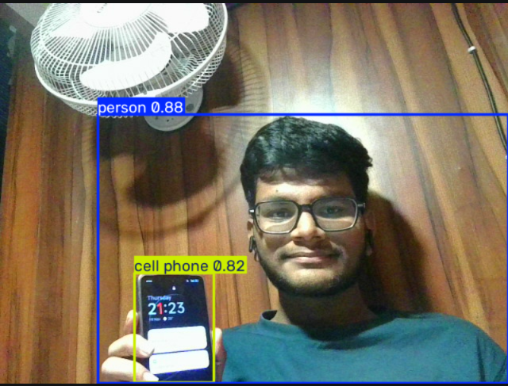

# DIGITAL_IMAGE_PROCESSING_TECHNIQUES_WS2
# YOLOv8 Real-Time Object Detection Using Webcam
# NAME:KARNAM PAREESH NAIDU
# REG.NO:212225230129
# DATE:18-11-2026
## 1. Project Description

This project implements object detection using the YOLOv8 (You Only Look Once) deep learning model. It captures an image from a computer's webcam and detects objects present in the captured frame.

YOLOv8 identifies multiple objects in an image, draws bounding boxes around detected objects, and displays their corresponding class labels and confidence scores.

The project uses Python, OpenCV, Ultralytics YOLOv8, Matplotlib, and PIL for image processing and visualization.

## 2. Technologies Used

- **Python:** Programming language used for implementation.
- **YOLOv8:** Deep learning model used for object detection.
- **OpenCV (cv2):** Used to access the webcam and capture images.
- **Matplotlib:** Image visualization library.
- **PIL (Pillow):** Used to display the processed image.
- **IPython:** Used to display images inside Jupyter Notebook.
- **VS Code:** Development environment.
- **Jupyter Notebook:** Used to execute Python code cell by cell.

## 3. Software Installation and Setup

### Step 1: Install Python

Download and install Python from:

https://www.python.org/downloads/

Verify the installation:

```bash
python --version
```

### Step 2: Install Visual Studio Code

Download VS Code:

https://code.visualstudio.com/

Install the following extensions:
- Python
- Jupyter

### Step 3: Create a Project Folder

Create a folder named `DIP1`.

Open this folder in Visual Studio Code.

### Step 4: Create a Virtual Environment

Open the VS Code terminal and execute:

```bash
python -m venv env1
```

### Step 5: Activate the Virtual Environment

For Windows:

```powershell
.\env1\Scripts\activate
```

### Step 6: Install Required Libraries

Upgrade pip:

```bash
python -m pip install --upgrade pip
```

Install Ultralytics YOLOv8:

```bash
python -m pip install ultralytics
```

Install OpenCV:

```bash
python -m pip install opencv-python
```

Install Matplotlib:

```bash
python -m pip install matplotlib
```

Install Pillow:

```bash
python -m pip install pillow
```

Install Jupyter and IPython kernel:

```bash
python -m pip install notebook ipykernel
```

Register the environment as a Jupyter kernel:

```bash
python -m ipykernel install --user --name env1 --display-name "Python (env1)"
```

### Step 7: Select the Python Kernel

1. Open the Jupyter Notebook in VS Code.
2. Click the kernel selection option at the top-right corner.
3. Select Python Environments.
4. Choose Python (env1).
5. Restart the kernel.

### Step 8: Verify YOLO Installation

Execute:

```python
from ultralytics import YOLO

print("YOLO installed successfully!")
```

## 4. Algorithm

1. Start the program.
2. Import the required Python libraries.
3. Load the pretrained YOLOv8 Nano model using `YOLO("yolov8n.pt")`.
4. Initialize the computer webcam using OpenCV.
5. Wait for 10 seconds before capturing the image.
6. Capture a single frame from the webcam.
7. Check whether the frame is captured successfully.
8. Pass the captured frame to the YOLOv8 model for object detection.
9. Detect objects and identify their corresponding classes.
10. Draw bounding boxes, class labels, and confidence scores on the detected objects.
11. Convert the image from BGR format to RGB format.
12. Display the annotated image using PIL and IPython.
13. Release the webcam.
14. Stop the program.

## 5. Code Explanation

### A. Import Required Libraries

```python
import cv2
import matplotlib.pyplot as plt
from ultralytics import YOLO
from IPython.display import display, clear_output
import time
from PIL import Image
```

- `cv2`: Used for webcam access and image capture.
- `matplotlib.pyplot`: Used for image visualization.
- `YOLO`: Imports the YOLO object detection model.
- `display`: Displays images inside Jupyter Notebook.
- `clear_output`: Clears previous notebook outputs.
- `time`: Provides time delay functionality.
- `Image`: Converts image arrays into displayable PIL images.

### B. Load YOLOv8 Model

```python
model = YOLO("yolov8n.pt")
```

Loads the pretrained YOLOv8 Nano model. The model is lightweight and suitable for object detection tasks.

The file `yolov8n.pt` contains pretrained model weights.

### C. Open Webcam

```python
cap = cv2.VideoCapture(0)
```

Initializes the webcam using OpenCV. The value `0` represents the default camera connected to the computer.

### D. Wait Before Capturing

```python
time.sleep(10)
```

Pauses the execution for 10 seconds before capturing the image.

### E. Capture a Single Frame

```python
ret, frame = cap.read()
```

Captures one frame from the webcam.

- `ret`: Indicates whether the frame was captured successfully.
- `frame`: Contains the captured image.

### F. Perform Object Detection

```python
results = model(frame)
```

Passes the captured frame to the YOLOv8 model. The model analyzes the image and identifies objects.

### G. Draw Bounding Boxes and Labels

```python
annotated_frame = results[0].plot()
```

Draws bounding boxes around detected objects and displays their class names and confidence scores.

### H. Convert BGR to RGB

```python
img = cv2.cvtColor(annotated_frame, cv2.COLOR_BGR2RGB)
```

OpenCV stores images in BGR format, whereas PIL uses RGB format. This conversion ensures correct image colors during display.

### I. Display the Detected Image

```python
display(Image.fromarray(img))
```

Converts the NumPy image array into a PIL image and displays the final object detection result inside Jupyter Notebook.

### J. Release Webcam

```python
cap.release()
```

Releases the webcam after image capture and processing to free the camera resource.

## 6. Working Principle

YOLOv8 uses a deep learning-based object detection approach. It processes the input image and predicts the locations and classes of objects present in the image.

The model generates bounding boxes around detected objects along with class labels and confidence scores. The final annotated image is displayed in the Jupyter Notebook.
# PROGRAM:
~~~
import cv2
import matplotlib.pyplot as plt
from ultralytics import YOLO
from IPython.display import display,clear_output
import time
from PIL import Image

# Load YOLOv8 model
model = YOLO("yolov8n.pt")

# Open webcam
cap = cv2.VideoCapture(0)

print("Camera started...")
print("Capturing frame in 5 seconds...")

# Wait for 5 seconds
time.sleep(10)

# Capture a single frame
ret, frame = cap.read()

if ret:
    # Perform object detection
    results = model(frame)

    # Draw bounding boxes and labels
    annotated_frame = results[0].plot()

    img=cv2.cvtColor(annotated_frame, cv2.COLOR_BGR2RGB)
    # Display the detected frame
    #clear_output(wait=True)
    #plt.figure(figsize=(8,6))
    #plt.imshow(img)
    #plt.axis("off")
    #plt.title("YOLOv8 Object Detection")
    #plt.show()
    display(Image.fromarray(img))
else:
    print("Failed to capture frame.")

# Release webcam
cap.release()
~~~
## 7. Expected Output

1. The webcam starts.
2. The program waits for 10 seconds.
3. A single image is captured.
4. YOLOv8 detects the objects present in the image.
5. Bounding boxes, object names, and confidence scores are displayed.
6. The processed image appears in the Jupyter Notebook.
# OUTPUT:

## 8. Applications

- Security and surveillance systems.
- Traffic monitoring.
- Pedestrian detection.
- Smart parking systems.
- Industrial automation.
- Object identification in images.
- Real-time computer vision applications.

## 9. Conclusion

This project demonstrates object detection using the pretrained YOLOv8 Nano model and a computer webcam. OpenCV is used to capture the image, YOLOv8 performs object detection, and PIL displays the annotated output.

The project provides practical knowledge of deep learning, digital image processing, computer vision, and object detection techniques.